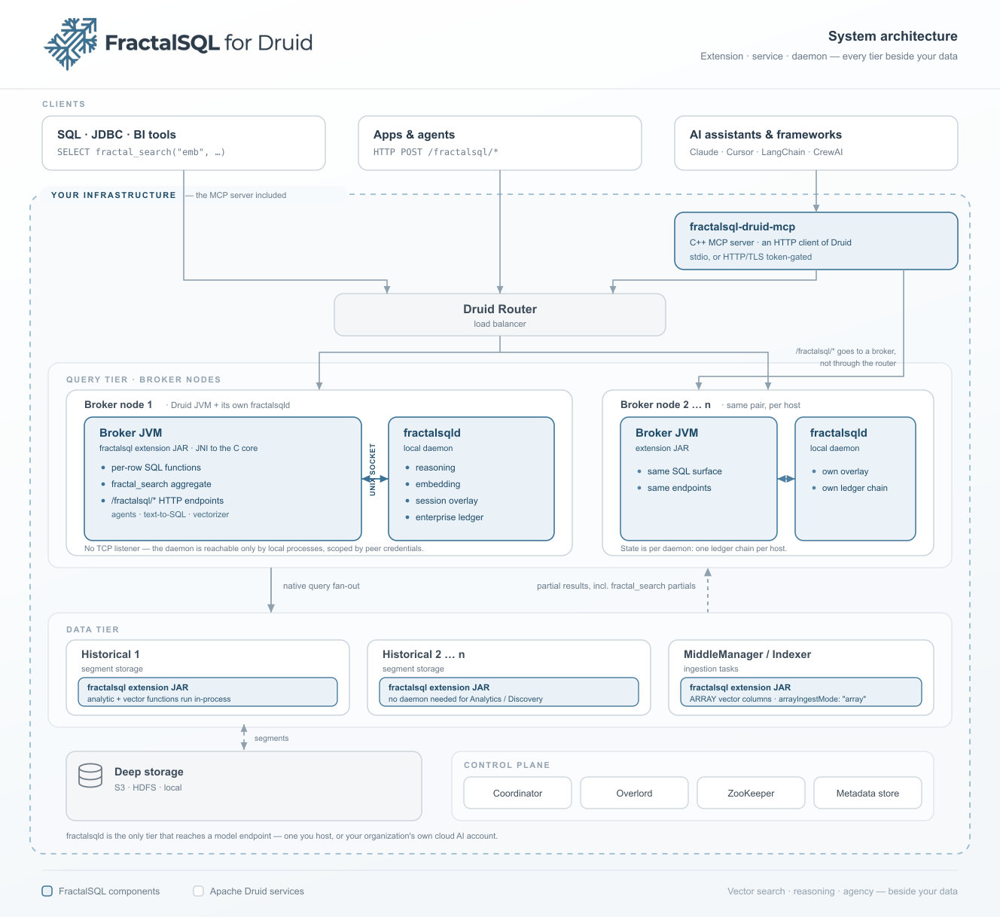

<p align="center">
  
</p>

# FractalSQL: Sovereign Data Intelligence
### AI Database Extension for Druid

**Vector Search. Reasoning. Production-Safe Agency. All beside your data.**

FractalSQL gives Apache Druid vector search, reasoning and agency, running beside
your data. It adds what traditional RAG (Retrieval-Augmented Generation)
stops short of: reasoning over what it retrieves, and when you enable it
acting on the result, whether that's running a generated query or executing a
decision an agent computed. The analytic functions run inside Druid, the agents
run as a service on your brokers, and reasoning runs in a small daemon beside
them. Everything stays on infrastructure you control.

By bringing reasoning and agency directly into the Druid extension, FractalSQL
enables **Sovereign Data Intelligence**: the ability to reason, plan, and act upon
your data with the deployment topology under your control. Run fully on-prem or in
your own containers with Ollama/vLLM for zero data egress, or point at your
organization's cloud AI accounts (Bedrock, Azure OpenAI, Vertex), where your compliance
posture requires it for managed-model scale. You control the trade, not the product.

| Traditional RAG Stack | The Sovereign Way (FractalSQL) |
| --- | --- |
| **Mode Collapse**: top-K search returns near-duplicates, starving the LLM of diverse context. | **Scout Discovery**: MMR-style diverse semantic search that discovers the data's real structure. |
| **Fragmented Logic**: app pulls rows, calls LLM, handles retries, and glues answers in middleware. | **Reasoning beside your data**: embedding and reasoning run in `fractalsqld` next to your brokers, with no middleware in the app. |
| **Passive Retrieval**: you ask a question, the DB returns rows, and you hope the LLM is correct. | **Autonomous Agency**: self-correcting SQL, loop detection, and trajectory forecasting. |

## From zero to your first agent

FractalSQL's docs follow a single linear path. Each step answers one question
and hands off to the next. You don't need to read everything; follow the path.

1. **What is this and why do I care?**: you are here. Sovereign Data Intelligence, in one page.
2. **How do I get the extension running in 60 seconds?** → [Getting Started](docs/getting-started.md) (load the extension into Druid, then your first Scout search).
3. **How do I apply this to my industry?** → [Starter Kits](docs/starter-kits.md): runnable, industry-specific SQL scripts (SOC, FinTech, MedTech, Fleet, Smart-Cities, automotive, aerospace, telecom, climate tech, RF, …).
4. **How does a specific agent work and what are its inputs?** → [Agent Recipes](docs/api-agency.md): the built-in agents, each as a recipe.
5. **How do I use this from my AI client instead of SQL?** → [MCP Plugin](docs/mcp-plugin.md): the `fractalsql-druid-mcp` server exposes the whole function surface as MCP tools for Claude Desktop, Cursor, Windsurf, Claude Code, LangChain, LlamaIndex, CrewAI, or any MCP client.
6. **How do I build a proprietary agent that isn't in the box?** → [Composition Guide](docs/composition-guide.md): the design patterns behind the recipes.

> New here? Step 2 is a one-command demo. Step 3 drops you into a vertical that
> looks like your problem. Step 4 is the reference you'll keep coming back to.

---

## 🎯 Who are you?

Depending on your role, you'll want to start in different places:

- **AI Engineer**: You want to improve RAG quality and reasoning.
  → Start with **[docs/features.md](docs/features.md)** and **[docs/reasoning-setup.md](docs/reasoning-setup.md)**.
- **DBA / Security Architect**: You care about stability, safety, and access control.
  → See the **[Safety & Governance guide](docs/text-to-sql-setup.md#secure-it-authorization-vs-correctness)**.
- **Product Developer**: You want to build agentic features quickly.
  → Run the **[Docker Demo](docs/docker-demo.md)**, then pick a **[Starter Kit](docs/starter-kits.md)**.
- **Tool Builder / Platform Engineer**: You want Claude Desktop, Cursor, Windsurf,
  an agent framework (LangChain, LlamaIndex, CrewAI), or your own runtime
  speaking to the database directly.
  → Serve the **[MCP Plugin](docs/mcp-plugin.md)**; the server-side details live in
  **[mcp/README.md](mcp/README.md)**.

---

## 🧩 What's in the box
<p align="center">
  
</p>
Four tiers of primitives, some SQL functions and some service calls, composable into
agents with plain SQL and application code: no server-side language required.

- **Discovery**: diverse, mode-collapse-free retrieval: `fractal_search` (Sniper), `fractal_search_explore` (Scout).
- **Cognition**: LLM integration through `fractalsqld`: `fractal_reason` (Bedrock, Azure OpenAI, Vertex, Ollama), `fractal_embed`, `fractal_text_to_sql`.
- **Agency**: self-correcting routines: the search/sql agents, plan/trajectory/loop-detection helpers; see the [Agent Recipes](docs/api-agency.md).
- **Analytics**: fractal/dimension primitives: `fractal_dimension_dfa`, `fractal_dimension_boxcount`, `fractal_optimize_portfolio`, and more.

Plus Druid-native plumbing: vectors as a Druid `ARRAY` column,
`fractal_search()` as a Druid SQL aggregate over that column, the
`fractal_vectorizer` embedding pipeline, and the tamper-evident
`fractal_ledger_*` audit surface. The full function-surface reference with
runnable examples lives in the [docs](docs/) and the [demo kits](demo/).

Everything above ships as a ready-made tool surface too: the bundled
`fractalsql-druid-mcp` MCP server turns the function catalog into 78 typed
tools (the surface every release verifies against committed
integrity locks). It speaks standard MCP over stdio or HTTP, so it drops into
any client or framework that does the same -- Claude Desktop, Cursor, Windsurf,
Claude Code, LangChain, LlamaIndex, CrewAI, the Vercel AI SDK -- under any
deployment topology from a local cluster to enterprise cloud reasoning
backends; see [Deployment topologies](docs/mcp-plugin.md#deployment-topologies).
See [MCP Plugin](docs/mcp-plugin.md) for the client-facing quickstart and
[mcp/README.md](mcp/README.md) for building and deploying the server binary.

Reasoning is opt-in and provider-pluggable: the `fractalsql-reasoning-http`
plugin speaks the OpenAI chat-completions wire format, so any OpenAI-compatible
endpoint works. Without a plugin configured, Discovery and Analytics are fully
functional, and the Cognition functions return NULL (the daemon's log says why).

---

## 🚀 Get it running

**How it fits together.** FractalSQL for Druid has three parts. The **extension**
loads into Druid and provides the SQL functions. The **service** is a set of HTTP
endpoints on the broker for the agents, text-to-SQL and the vectorizer.
**`fractalsqld`** runs next to the brokers and holds the model connection and the
enterprise ledger.

FractalSQL for Apache Druid ships as a **Druid extension**: a JAR that a
Druid node loads through `druid.extensions.loadList`. The JAR carries a
JNI shim linked against the pure-C FractalSQL core, so the per-row functions
and the `fractal_search` aggregate run inside the Druid process.

```bash
# Build the extension and run the whole gate suite against a real Druid
./build_test.sh

# Or just the demo stack: ZooKeeper, coordinator(+overlord), broker,
# historical, middle manager and router, with the extension loaded.
docker compose -f docker/docker-compose.yml up -d
```

```sql
-- Against the router's SQL endpoint on :8888
SELECT "id", fractal_search("emb", '[1.0,0.0,0.0]') AS "dist"
FROM "demo_vecs"
GROUP BY "id"
ORDER BY "dist" ASC
LIMIT 10;
```

```sql
-- The analytic and vector functions are native expressions:
-- they evaluate per row. Druid needs every projected column to be a
-- grouping key, so the vector column joins the row's identity in the
-- GROUP BY -- which is still one group per row.
SELECT "id",
       fractal_vector_cosine_distance("emb", '[1.0,0.0,0.0]') AS "dist",
       fractal_dimension_dfa("series") AS "dfa"
FROM "demo_vecs"
GROUP BY "id", "emb", "series"
ORDER BY "dist" ASC
LIMIT 10;
```

**How the tiers are served on Druid.** The per-row functions (68 of them) are Druid
SQL expressions, and `fractal_search` is a Druid SQL aggregate. The operations that need
to run a query or hold state (the agents, text-to-SQL, the vectorizer, the table-backed
searches) are HTTP endpoints under `/fractalsql`. Reasoning, embedding and the enterprise
ledger run in `fractalsqld`, a service that runs on the same host as the Druid brokers that call it. The details are in
**[Druid integration](docs/druid-integration.md)**.

**[druid-extension/README.md](druid-extension/README.md)** has the build,
install and test details. **[Getting Started](docs/getting-started.md)**
walks through the whole thing.

Apache Druid supports Linux and macOS, so those are the platforms the
extension ships for: x86-64 and ARM64 on each.

---

## 🏛️ Enterprise Tier

Everything above is Community edition and fully functional on its own.
Discovery, Cognition, and Agency don't depend on anything in this section.
For regulated environments that need to **prove, not just trust**, a
decision: the Enterprise tier adds a tamper-evident, HMAC-sealed decision
record; **[Enterprise Tier](docs/enterprise.md)** has the full mechanism,
including what the ledger can and can't prove.

On Druid the tier is the separately licensed **FractalSQL Enterprise
core**, installed into the node's image and loaded at run time after its
detached Ed25519 signature has been verified — it is not part of the
extension JAR, and a Community deployment needs none of it.

---

## 📊 Compatibility & License

| Apache Druid | Java | Linux amd64 | Linux arm64 | macOS |
| --- | --- | :---: | :---: | :---: |
| 38 | 21, 25 | ✓ | ✓ | ✓ |
| 37 | 17 | ✓ | ✓ | ✓ |

`fractalsqld` runs on Java 17 or newer.

The extension is a JAR loaded through `druid.extensions.loadList`. It
carries a native payload for each supported platform (x86-64 and ARM64 on
Linux and macOS) and loads the one that matches the JVM.

**License**: Apache-2.0. See `LICENSE`. Third-party components are under
their own permissive licenses (BSD-2-Clause, MIT, and others) --
see `THIRD-PARTY-NOTICES.md`.

For enterprise editions, licensing, and support, contact
**enterprise@fractalsqlabs.com**.

---

## 📚 Documentation

*Follow the path above; the links below are the same steps, expanded.*

- **[Getting Started](docs/getting-started.md)**: build the extension, load it into Druid, run your first search.
- **[Druid Integration](docs/druid-integration.md)**: which parts are SQL expressions and which are service calls, the Druid constraints behind that, and the known limits.
- **[Extension Reference](druid-extension/README.md)**: the build, install and test reference for the extension module.
- **[Starter Kits](docs/starter-kits.md)**: industry-specific runnable SQL scripts.
- **[Agent Recipes](docs/api-agency.md)**: the sixteen installable agents, each as a recipe.
- **[Composition Guide](docs/composition-guide.md)**: build your own agent.
- **[Features](docs/features.md)**: the full Capability Map and API reference.
- **[Reasoning Setup](docs/reasoning-setup.md)**: LLM provider configuration (Ollama, OpenAI, Bedrock, Azure, Vertex).
- **[Text-to-SQL Setup](docs/text-to-sql-setup.md)**: pipeline details and the security model.
- **[Vectorizer Setup](docs/vectorizer-setup.md)**: automatic embedding pipelines.
- **[MCP Plugin](docs/mcp-plugin.md)**: use FractalSQL from Claude Desktop, Cursor, Windsurf, LangChain, LlamaIndex, CrewAI, and many more MCP clients.
- **[FractalSQL Daemon](docs/fractalsql-daemon.md)**: running `fractalsqld` by hand, its config file, the `fsqlctl` CLI, and what a daemon crash does (and doesn't) do to your Druid cluster.
- **[Docker Demo](docs/docker-demo.md)**: a one-command end-to-end demo.
- **[Agent Blueprint Gallery](demo/README.md)**: the vertical demos and reference agents.
- **[Enterprise Tier](docs/enterprise.md)**: the tamper-evident decision ledger (CISO/audit).