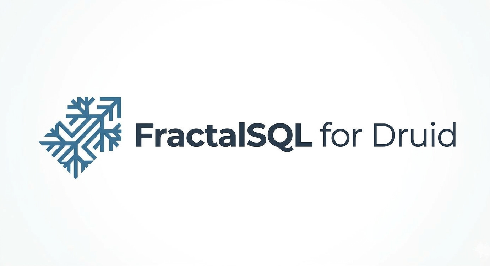

<p align="center">
  
</p>

# Sovereign Agency

FractalSQL is bundled with **sixteen installable agents**: autonomous,
self-correcting routines that compose the extension's Discovery, Analytics, and
Cognition primitives into end-to-end workflows. Each agent is a *recipe* for a
recurring agentic pattern: "drift on a metric series," "match a task to the best
capable sub-agent," "block an action near a known-bad state." You pick the recipe
that matches your problem, point it at your tables and columns, and get back real
computed results plus a human-readable read.

> **On Druid the agents are a service, not SQL functions.** A Druid SQL function
> cannot issue another query, so a routine that has to *read a datasource and reason
> over it* cannot be a function at all. The sixteen agents live on the extension's
> **service tier** (`POST /fractalsql/agent/<name>`), which reads the rows through the
> broker's SQL engine, computes with the core, reasons through the provider, and
> returns one JSON decision document. The primitives they compose
> (`fractal_dimension_dfa`, `fractal_vector_l2_distance` and the rest) *are* ordinary
> SQL functions. The shape of the extension, and which tiers are SQL expressions and
> which are service calls, are described in [Druid Integration](druid-integration.md).

This page is written for the **driver**, not the mechanic. For each agent you'll
find: what problem it solves, when to reach for it, the inputs it needs, how it
works inside, what it returns, a runnable example, and the non-obvious notes.
If you want to build a recipe that isn't in the box, see
[Composing your own](#composing-your-own) and the six Universal Agent building
blocks further down.

> **What's an "installable agent" vs. a "Universal Agent" vs. a "Domain Agent"?**
> The **installable agents** (below) are the productized recipes: sixteen
> service operations. The **Universal Agents** (lower down) are the six building
> blocks the installable agents compose. The **Domain Agents** are the reference
> blueprints in the agentic starter kits (`demo/demo-vertical-agentic-*.sql`); the
> installable agents are their productized, parameterized form.

---

## Install

**Druid difference:** there is no separate agents extension and no separate
install/activation step at all: the extension carries the sixteen agents (plus the
six Universal Agents), and they are callable as soon as Druid has loaded it:
```properties
druid.extensions.loadList=["fractalsql-druid", ...]
```

Thirteen are **cognition** agents that end in a `fractal_reason` step and need
reasoning configured (see [`reasoning-setup.md`](reasoning-setup.md)). Three are
**pure retrieval/analytics** with no LLM step (`recall_hybrid`,
`recommend_diverse`, `feedback_audit`) and need no endpoint. One
(`diverse_portfolios`) is enterprise tier; see its recipe below. Confirm
reasoning before running the cognition agents:

```sql
SELECT fractal_reason('reply with a short confirmation', '');
```

---

## Which agent should I use?

Pick by the problem shape, not by the function name.

| Your problem | Agent | Recipe in one line | LLM? |
| --- | --- | --- | --- |
| "Is this entity's metric series drifting into a new regime?" (table-backed, per-entity) | `anomaly_triage` | drift exponent on one entity's series → LLM triage | ✓ |
| "Is this single series in a regime change?" (array-in, no table) | `regime_triage` | DFA + drift over one series → LLM triage | ✓ |
| "Did this vessel/host track deviate from the fleet?" | `track_anomaly` | trajectory deviation + heading DFA → LLM triage | ✓ |
| "Did this vehicle detour, and how complex is its GPS trace?" | `detour_classify` | trajectory deviation + box-counting → LLM classify | ✓ |
| "Is my sensor grid's coverage degrading?" | `network_coverage_alert` | spatial morphology + telemetry drift → LLM alert | ✓ |
| "What's the best cardinality-constrained allocation?" | `allocate` | SFS Sharpe optimizer → LLM rationale | ✓ |
| "Rebalance, and compare to the nearest historical allocation?" | `rebalance_sibling` | optimizer + trajectory search → LLM rationale | ✓ |
| "Give me several distinct good portfolios, not just one?" (enterprise) | `diverse_portfolios` | multimodal optimizer → LLM tradeoff summary | ✓ |
| "Which sub-agent should handle this incoming task?" | `route_task` | nearest-capability search + budget accounting → LLM rationale | ✓ |
| "Which node should this workload land on (with vector refinement)?" | `schedule_workload` | `fractal_search` refine + nearest node → LLM rationale | ✓ |
| "Should I block this proposed action (is it near a known-bad state)?" | `outlier_intercept` | distance-to-bad-state safety barrier → LLM justification | ✓ |
| "Triage a patient against a cohort + baseline→current drift" | `patient_deterioration_triage` | cohort search + trajectory drift → LLM triage | ✓ |
| "Ask a natural-language question over my tables" | `data_analyst` | NL→SQL→execute → LLM analysis | ✓ |
| "Recall similar past memories, restricted by a metadata filter" | `recall_hybrid` | cohort-restricted vector recall | No LLM |
| "Recommend diverse items, avoiding recently-rejected ones" | `recommend_diverse` | repulsion-diverse top-k | No LLM |
| "Audit my recommender's diversity health" | `feedback_audit` | diversify loop + collapse detection | No LLM |

> **A guarantee about the outputs.** Every output field is a **real primitive
> result, not a literal**. `threat_score` is the computed drift exponent;
> `allocation`/`sharpe` are the optimizer's own `{sharpe, weights}` document and
> risk-adjusted return (no hardcoded `0.042`); `routed_to` is the real nearest
> capability name and `confidence` is `1/(1+distance)`; `intercepted` is a real
> distance-vs-threshold comparison; `memories` are the real recalled rows' ids and distances;
> `item_id`/`score` are the real catalog id and `1 − cosine_distance`. The
> thirteen cognition agents' `triage_summary` / `rationale` / `analysis`
> fields are real `fractal_reason` output. Every agent raises a clean `ERROR`
> on bad input (empty target table, NULL series, filter matching no rows) with
> an agent-named message.

---

### How an agent is called

An agent is a JSON request to `POST /fractalsql/agent/<name>` that returns one JSON
document. The demo runner makes the same call with a directive, and can materialise the
result so a later statement can query it:

```sql
-- @call agent/track_anomaly {"track_table": "ag_tracks", "emb_col": "current", ...} AS ag_track;
SELECT "nearest_fleet_id", "trajectory_distance" FROM "ag_track";
```

The tables below list each agent's request keys. Their types are `string`, `int`,
`float` and `vector` (a CSV string such as `'0.1,0.2,0.3'`, or a bracketed JSON array). A
vector or array argument `x` may instead be read from one row of a datasource by naming it
with `x_table` and `x_column`: that is how a value computed by earlier SQL is passed in.
The identity column is named `id_col` (the service also accepts `id_column`).

The extension carries:

* all **sixteen domain recipes**: `anomaly_triage`, `allocate`,
  `route_task`, `outlier_intercept`, `recall_hybrid`, `recommend_diverse`,
  `data_analyst`, `patient_deterioration_triage`, `feedback_audit`,
  `schedule_workload`, `rebalance_sibling`, `diverse_portfolios`,
  `detour_classify`, `track_anomaly`, `network_coverage_alert`,
  `regime_triage`;
* the six **Universal Agents**: `search_agent`, `rag_agent`, `plan_explore`,
  `trajectory_predict`, `detect_loop` and `sql_agent`;
* `outlier_screen`, the table-driven form of the interceptor.

**`diverse_portfolios` is enterprise-gated**: its core symbols are not in the community
archive, so it needs the licensed core (`enterprise_lib` in `fractalsqld.conf`, see
[Enterprise Tier](enterprise.md#enabling-it)). Without it, that one agent reports that
the tier is not loaded.

**Partial results.** An agent that computes a result and then reasons over it returns the
computed half plus a `reasoning_step_failed` field when the model call fails or answers
with nothing, instead of raising. Send `"partial": false` to make that case an error
(HTTP 502).

**Which reasoning context an agent reaches for.** The reasoning tier
runs through four independent contexts: chat, text-to-SQL, review and
embed, each with its own response mode (see
[`reasoning-setup.md § Response Modes`](reasoning-setup.md#the-four-contexts-on-druid)).
An agent's *rationale* is prose and runs on the **chat** context, whose
response mode is the operator's choice. An agent that *generates a
statement*, the data analyst and the SQL agent, runs on the
**text-to-SQL** context, whose mode is code, so the statement arrives
without the prose it was written in. An agent that *embeds* runs on the
**embed** context. Only the chat context's mode is configurable; the
other three are fixed to what they are for.

---

## The sixteen recipes

### Anomaly triage: `fractal_agent_anomaly_triage`
**Triage drift on one entity's metric time series.**

Use it when you have a per-entity metric series in a table (latency, error rate,
vitals, sensor reading) and want to know whether that entity has drifted into a
new regime: Cybersecurity host triage, DevOps incident triage, MedTech patient
monitoring, Smart-Cities sensor regime change. For a single series you already
hold as an array (no per-row table), use [regime_triage](#regime-triage-fractal_agent_regime_triage)
instead.

**Inputs**

| Argument | Type | Default | What it is |
| --- | --- | --- | --- |
| `log_table` | `string` | (none) | your metric table |
| `metric_col` | `string` | (none) | the numeric metric column to read as the series |
| `time_col` | `string` | (none) | the timestamp column to order the series by |
| `filter_col` | `string` | (none) | the entity-id column to filter on (e.g. `host`) |
| `filter_val` | `string` | (none) | which entity (e.g. `'host-1'`) |
| `baseline_window` | `int` | `32` | recent-window size for the drift comparison |

**How it works.** (1) Reads the entity's metric series from the datasource, ordered by
`time_col`. (2) Runs `fractal_dimension_drift(series, baseline_window)`
for the regime-change drift exponent. (3) Calls `fractal_reason` to synthesize a
human-readable triage over the drift result.

**Returns** a JSON document: `{"threat_score":..,"anomaly_type":"vector_drift","triage_summary":".."}`.
`threat_score` is the real drift exponent; `anomaly_type` is the literal
`'vector_drift'` label; `triage_summary` is the LLM's read.

**Example**
```sql
-- @fixture ag_logs {"rows": [
--   {"id": 1, "seq": 1, "host": "host-1", "metric": 51.3},
--   ...
-- ]};

-- @call agent/anomaly_triage {"log_table": "ag_logs", "metric_col": "metric",
--                             "time_col": "seq", "filter_col": "host",
--                             "filter_val": "host-1", "baseline_window": 32} AS ag_triage;

SELECT "threat_score" AS "threat_score", "anomaly_type" AS "anomaly_type"
FROM "ag_triage";
```

**Notes.** Raises `fractal_agent_anomaly_triage: no rows in …` if the filter
matches no rows. `baseline_window` must be large enough for DFA (16 is too small
and returns `rc=-1`; 32 is safe).

---

### Allocate: `fractal_agent_allocate`
**Cardinality-constrained portfolio allocation.**

Use it when you want the best allocation of a fixed number of assets from a
universe: Quant-Finance portfolios, Sovereign-Edge resource allocation, FinTech
rebalancing. You supply expected returns (`mu`) and risk (`cov`); the agent runs
the SFS Sharpe maximizer and reasons a rationale.

**Inputs**

| Argument | Type | Default | What it is |
| --- | --- | --- | --- |
| `mu` | `vector` | (none) | expected returns per asset |
| `cov` | `vector` | (none) | covariance matrix, **flattened 1-D row-major n×n** |
| `cardinality` | `int` | (none) | how many assets to hold |
| `context` | `string` | `NULL` | optional label passed to the reason call |

**How it works.** (1) `fractal_optimize_portfolio(mu, cov, cardinality)`: the
SFS cardinality-constrained Sharpe maximizer. (2) Extracts the real Sharpe from
the optimizer's own output. (3) `fractal_reason` explains the allocation.

**Returns** a JSON document: `{"allocation":"{..}","sharpe":..,"rationale":".."}`. `allocation` is
the optimizer's own `{sharpe, weights, cardinality}` document (as text); `sharpe` is the real
risk-adjusted return; `rationale` is the LLM's explanation.

**Example**
```sql
-- @fixture ag_portfolio {"rows": [
--   {"mu": "0.05,0.1", "cov": "1,0,0,1"},
--   ...
-- ]};

-- @call agent/allocate {"mu_table": "ag_portfolio", "mu_column": "mu",
--                      "cov_table": "ag_portfolio", "cov_column": "cov",
--                      "cardinality": 1} AS ag_alloc_result;

SELECT "sharpe" AS "sharpe" FROM "ag_alloc_result";
```

**Notes.** `cov` must be a **flattened 1-D row-major** matrix, not a 2-D array.
A mismatched `cov` length surfaces the primitive's clean `cov length` error.

---

### Route task: `fractal_agent_route_task`
**Match an incoming task to the best capable sub-agent.**

Use it as a sub-agent dispatcher: DevOps task routing, Customer Support
intent routing, Cybersecurity analyst routing, Sovereign-Edge orchestration. You
pass the task as an embedding (the agent does not embed it for you); it finds the
nearest capability row and accounts a token budget.

**Inputs**

| Argument | Type | Default | What it is |
| --- | --- | --- | --- |
| `task_emb` | `vector` | (none) | the incoming task's embedding (same dim as the capability embeddings) |
| `cap_table` | `string` | (none) | your capability/sub-agent table |
| `cap_emb_col` | `string` | (none) | the embedding column in that table |
| `cap_id_col` | `string` | (none) | the column to return as the routed-to name |
| `budget` | `int` | (none) | the caller's token budget |
| `cost_per_route` | `int` | `150` | tokens one routing decision costs |

**How it works.** (1) `fractal_search_telemetry(cap_table, cap_emb_col, task_emb, 1)`
finds the nearest capability. (2) Resolves the returned `doc_id` (the value of the identity column) to the named capability id via the
[id-resolution mapping](#a-note-on-id-resolution). (3) Derives
`confidence = 1/(1+distance)`, accounts `remaining_budget = budget − cost_per_route`.
(4) `fractal_reason` writes a one-line routing rationale.

**Returns** a JSON document: `{"routed_to":..,"confidence":..,"remaining_budget":..,"rationale":".."}`.

**Example**
```sql
-- @fixture ag_caps {"rows": [
--   {"id": 1, "capability_name": "root-cause-analyzer", "emb": "0.1,0.2,0.3"},
--   ...
-- ]};

-- @call agent/route_task {"task_emb": "0.11,0.21,0.31", "cap_table": "ag_caps",
--                        "cap_emb_col": "emb", "cap_id_col": "capability_name",
--                        "budget": 1000} AS ag_route;

SELECT "routed_to" AS "routed_to", "confidence" AS "confidence",
       "remaining_budget" AS "remaining_budget"
FROM "ag_route";
```

**Notes.** Raises `no capability rows in …` if the capability table is empty
(the agent pre-checks so its message fires before the C primitive's
`no corpus rows to search`).

---

### Outlier intercept: `fractal_agent_outlier_intercept`
**Pre-commit safety barrier against known-bad states.**

Use it as a pre-commit screen on a proposed action's state vector: DevOps action
screening, Cybersecurity known-bad-state interception, MedTech out-of-range
vital interception, Sovereign-Edge anomalous command interception. It measures
the distance from the proposed state to the nearest known-bad state and intercepts
if that distance is within a threshold.

**Inputs**

| Argument | Type | Default | What it is |
| --- | --- | --- | --- |
| `state_vec` | `string` | (none) | the proposed action's state vector (CSV/JSON vector) |
| `history_table` | `string` | (none) | your known-bad-state table |
| `emb_col` | `string` | (none) | the embedding column in that table |
| `threshold` | `float` | (none) | intercept if the nearest bad state is within this distance |
| `metric` | `string` | `'cosine'` | the distance measure: `'cosine'` (exact telemetry engine, ignores magnitude) or `'l2'` (exact Euclidean). Any other value raises `metric must be 'cosine' or 'l2'`. |

**How it works.** (1) Finds the distance from the proposed state to the nearest
known-bad state under the caller-chosen metric: `'cosine'` runs
`fractal_search_telemetry(history_table, emb_col, state_vec, 1)`; `'l2'` is an
exact `ORDER BY` over `fractal_vector_l2_distance(col, state_vec)` in ordinary
SQL (there is no operator syntax in Druid; the function IS the operator).
(2) `intercepted = distance < threshold`, a real comparison of a real distance.
(3) `fractal_reason` justifies the decision in one sentence (naming the metric
actually used, so the threshold's own basis is auditable).

**Returns** one TEXT JSON document: `{"intercepted":true|false,"metric":"cosine"|"l2","reason":".."}`.

**Example**
```sql
-- @fixture ag_badstates {"rows": [
--   {"id": 1, "emb": "1.0,0.0,0.0"},
--   ...
-- ]};

-- @call agent/outlier_intercept {"state_vec": "0.95,0.05,0.0",
--                                "history_table": "ag_badstates", "emb_col": "emb",
--                                "threshold": 0.5} AS ag_out_near;

SELECT "intercepted" AS "intercepted", "metric" AS "metric"
FROM "ag_out_near";
```

**Notes.** Cosine distance **ignores magnitude**: `[0.1,0.1,0.1]` vs
`[0.9,0.9,0.9]` are parallel (distance 0, "near"), not far. To build a "far"
known-bad fixture, point a *different direction* (e.g. `[0,1,0]` vs `[1,0,0]` →
distance 1). If magnitude should count, pass `'l2'`: there, `[0.05,0,0]` sits
~0.856 away from the bad pair above and is allowed under the same
threshold. Raises `no bad-state rows in …` if the history table is empty.

---

### Recall hybrid: `fractal_agent_recall_hybrid`
**Cohort-restricted vector recall (no LLM).**

Use it for memory recall restricted by a metadata filter: Customer Support memory
recall, MedTech cohort-restricted patient search, Smart-Cities zone-filtered
sensor recall. The "hybrid" is the cohort: a strict SQL filter applied *before*
the vector search so `k` is respected within the cohort.

**Inputs**

| Argument | Type | Default | What it is |
| --- | --- | --- | --- |
| `mem_table` | `string` | (none) | your memory/corpus table |
| `vec_col` | `string` | (none) | the embedding column |
| `query_vec` | `vector` | (none) | the query embedding |
| `filter_col` | `string` | `NULL` | metadata column to filter on (NULL = no filter, search all) |
| `filter_val` | `string` | `NULL` | the value to match |
| `k` | `int` | `5` | how many results |
| `id_col` | `string` | `'id'` | the column to return as the id (must be an integer key) |

**How it works.** (1) Builds a cohort of row identities from the optional filter. (2)
`fractal_hybrid_clinical_search` restricts the vector search to that cohort. (3)
Returns the recalled rows' ids (the value of `id_col`) with their distances.

**Returns** a JSON document: `{"memories":[{"doc_id":..,"distance":..},..],"rows":[..],"n_corpus":N}`.
`memories` are the real nearest rows within the cohort, nearest first: each `doc_id` is the value of
`id_col` and `distance` the exact cosine distance. `rows` repeats the list. The agent returns ids, not
content: join them to your datasource for the text (see the example).

**Example**
```sql
-- @fixture ag_mem {"rows": [
--   {"id": 1, "session_id": 1001, "customer_id": "cust-a", "state_vector": "0.2,0.2,0.2", "content": "resolved churn via loyalty upgrade"},
--   ...
-- ]};

-- @call agent/recall_hybrid {"mem_table": "ag_mem", "vec_col": "state_vector",
--                            "query_vec": "0.18,0.22,0.2", "id_col": "session_id",
--                            "filter_col": "customer_id", "filter_val": "cust-a",
--                            "k": 2} AS ag_recall;

SELECT r."doc_id" AS "mem_id", m."content" AS "content", r."distance" AS "distance"
FROM "ag_recall" r, "ag_mem" m
WHERE r."doc_id" = m."session_id";
```

**Notes.** Raises `filter matched no rows in …` if the filter matches nothing.
`id_col` must be an integer key. This agent takes a single
`(filter_col, filter_val)`. For a multi-predicate cohort (e.g.
`age>65 AND condition='sepsis'`), build the cohort yourself and use [patient_deterioration_triage](#patient-deterioration-triage-fractal_agent_patient_deterioration_triage),
which accepts a caller-built `cohort_doc_ids`.

---

### Recommend diverse: `fractal_agent_recommend_diverse`
**Feedback-aware diverse top-k recommendations (no LLM).**

Use it when you want diverse candidates that avoid recently-rejected items:
Customer Support diverse recovery strategies, Recommendation "you might also
like," Smart-Cities diverse representative-zone sampling. It enables the
session-global Diversify/Repulsion layer, then runs a repulsion-diverse top-k.

**Inputs**

| Argument | Type | Default | What it is |
| --- | --- | --- | --- |
| `catalog_table` | `string` | (none) | your catalog table |
| `emb_col` | `string` | (none) | the embedding column |
| `query_vec` | `vector` | (none) | the query embedding |
| `k` | `int` | `10` | how many results |
| `id_col` | `string` | `'id'` | the column to return as the id (must be an integer key) |

**How it works.** (1) `fractal_diversify_enable()`: session-global repulsion, so
re-searches avoid recently-rejected items reported via
`fractal_feedback_report`. (2) `fractal_search_telemetry` for the top-k, which the
primitive applies repulsion to when diversify is enabled. (3) Resolves the
returned `doc_id` (the row's position in the scan) to your named id via the
[id-resolution mapping](#a-note-on-id-resolution).

**Returns** a JSON document: `{"items":[{"item_id":..,"score":..},..]}`: `score = 1 − cosine_distance`,
real from the primitive (not canned `0.95 − i*0.01`).

**Example**
```sql
-- @fixture ag_catalog {"rows": [
--   {"id": 10, "emb": "0.1,0.0,0.0"},
--   ...
-- ]};

-- @call agent/recommend_diverse {"catalog_table": "ag_catalog", "emb_col": "emb",
--                                "query_vec": "0.12,0.01,0.0", "k": 3,
--                                "id_col": "id"} AS ag_diverse;

SELECT "item_id" AS "item_id", "score" AS "score"
FROM "ag_diverse";
```

**Notes.** `fractal_diversify_enable()` is a **session-global side effect**:
this agent leaves it on; you are responsible for `fractal_diversify_disable()`
when done. (Contrast [feedback_audit](#feedback-audit-fractal_agent_feedback_audit), which
self-disables.) `id_col` must be an integer key.

---

### Data analyst: `fractal_agent_data_analyst`
**Natural-language analytics over any of your tables.**

The horizontal catch-all: the closest thing to a general-purpose agent in the
roster. Use it when no vertical agent fits and you just want to ask a
natural-language question over your tables and get a reasoned answer. It composes
`fractal_sql_agent` (NL→SQL→execute, with its own retry loop) then `fractal_reason`
to synthesize a read of the result. No vertical demo is wired to it.

**Inputs**

| Argument | Type | Default | What it is |
| --- | --- | --- | --- |
| `question` | `string` | (none) | the natural-language question |
| `table_names` | `string[]` | `NULL` | the tables the agent may query |
| `max_retries` | `int` | `2` | how many correction loops on plan-check failure |

**How it works.** (1) `fractal_sql_agent(question, table_names, max_retries, auto_execute)`:
NL→SQL, with `auto_execute=1` so the statement is run and `result_json` carries
the real row count (or a captured execution-failure reason); with `auto_execute=0`
the statement is validated but not run and `result_json` is NULL. (2) `fractal_reason`
writes a one-paragraph analysis over the result -- only when the statement was run.

**Execution is opt-in.** The agent never runs a statement it generated unless the
caller asks it to. The default call generates and validates the SQL and hands it
back in `generated_sql`, so you can read it and run it yourself; `analysis` and
`result_json` are then NULL. Pass `auto_execute` as `1` for the full
NL→SQL→run→reason path.

**Returns** a JSON document: `{"question":..,"generated_sql":..,"execution_status":"success","result_rows":[..],"analysis":".."}`:
`analysis` is the LLM's read; `generated_sql` and `result_rows` are the SQL
agent's own real outputs (no canned constants).

**Example**
```sql
-- @call agent/data_analyst {"question": "total amount spent per category in ag_data",
--                           "table_names": "[\"ag_data\"]", "max_retries": 3} AS ag_analyst;

SELECT "question" AS "question", "generated_sql" AS "generated_sql",
       "execution_status" AS "execution_status"
FROM "ag_analyst";
```

**Notes.** No empty-table guard: there is no fixed table to pre-check;
`fractal_sql_agent` handles its own errors and reports empty/failed results via
`execution_status`. Guard the LLM-facing `fractal_sql_agent` step with a
restricted role (see [Safe Agency & Guardrails](composition-guide.md#safe-agency--guardrails)).

---

### Patient deterioration triage: `fractal_agent_patient_deterioration_triage`
**Cohort-restricted patient triage with baseline→current drift.**

Use it for clinical deterioration triage, or any "nearest patient within a
cohort *plus* baseline→current drift" workflow. The `cohort_doc_ids` parameter
accepts a caller-built multi-predicate cohort (e.g. `age>65 AND condition='sepsis'`)
that [recall_hybrid](#recall-hybrid-fractal_agent_recall_hybrid)'s single
`(filter_col, filter_val)` cannot express.

**Inputs**

| Argument | Type | Default | What it is |
| --- | --- | --- | --- |
| `patient_table` | `string` | (none) | your patient/corpus table |
| `vec_col` | `string` | (none) | the embedding column |
| `query_vec` | `string` | (none) | the patient to triage (CSV/JSON vector) |
| `baseline_vec` | `string` | (none) | the baseline state for the drift search |
| `current_vec` | `string` | (none) | the current state for the drift search |
| `cohort_doc_ids` | `string` | `NULL` | caller-built cohort (JSON array of row identities; NULL = all rows) |
| `k` | `int` | `5` | how many cohort neighbors |
| `id_col` | `string` | `'id'` | the column to return as the id (must be an integer key) |

**How it works.** (1) Builds the cohort: from `cohort_doc_ids` if supplied (a
JSON array of row identities), else
every row's id. (2)
`fractal_hybrid_clinical_search` for up to `k` nearest patients in the cohort,
ranked ascending by distance, each resolved to its named patient id via a
direct id predicate (the
[id-resolution mapping](#a-note-on-id-resolution)) in the same query. (3)
`fractal_search_trajectory` for the baseline→current drift, always a single
result; `k` does not apply here. (4) `fractal_reason` synthesizes the triage
over the single nearest cohort match and the drift, not over the whole
cohort.

**Returns** a JSON document: `{"nearest_cohort_id":..,"cohort_distance":..,"drift_distance":..,"cohort_matches":[{"id":..,"distance":..},..],"rationale":".."}`.
`cohort_matches` lists the cohort neighbours found (up to `k`), nearest first; `nearest_cohort_id` and
`cohort_distance` describe the nearest one. `drift_distance` is the distance from the movement
(current minus baseline) to the nearest stored row, or `0` when nothing is stored.

**Example**
```sql
-- @fixture ag_patients {"rows": [
--   {"id": 1, "age": 72, "condition": "sepsis", "vitals": "0.90,-0.80,0.70,0.60"},
--   ...
-- ]};

-- the cohort, computed with ordinary SQL and kept in one cell
REPLACE INTO ag_cohort OVERWRITE ALL
SELECT ARRAY_TO_STRING(ARRAY_AGG(CAST("id" AS VARCHAR), 8192), ',') AS "ids"
FROM "ag_patients" WHERE "age" > 65 AND "condition" = 'sepsis'
PARTITIONED BY ALL;

-- @call agent/patient_deterioration_triage {"patient_table": "ag_patients",
--     "vec_col": "vitals", "id_column": "id", "query_vec": "0.9,-0.8,0.7,0.6",
--     "baseline_vec": "0.1,0.1,0.1,0.1", "current_vec": "0.95,-0.85,0.75,0.65",
--     "cohort_doc_ids_table": "ag_cohort", "cohort_doc_ids_column": "ids",
--     "k": 5} AS ag_patient;

SELECT "nearest_cohort_id" AS "nearest_cohort_id",
       "cohort_distance" AS "cohort_distance",
       "drift_distance" AS "drift_distance",
       "cohort_matches" AS "cohort_matches"
FROM "ag_patient";
```

**Notes.** Raises `no patient rows in …` if the table is empty, or `cohort
matched no rows in …` if the cohort is empty. `id_col` must be an integer key.
Cohort doc_ids are the id column's values:
`ARRAY_AGG("id")` over the patient table (see
[id resolution](#a-note-on-id-resolution)), and the caller-supplied
`cohort_doc_ids` array must be ids on that same table.
`k` controls only the cohort-search width; the drift search always compares a
single baseline point to a single current point, so it stays fixed at its
nearest point regardless of `k`.

---

### Feedback audit: `fractal_agent_feedback_audit`
**Recommender diversity audit (pure analytics, no LLM).**

Use it to audit a recommender's diversity health: a self-contained cycle that
enables session-global repulsion, warms the rolling diversity window with varied
queries, reports negative feedback on a target result, then reads back the
diversity quotient and session diagnostics. Unlike [recommend_diverse](#recommend-diverse-fractal_agent_recommend_diverse),
this agent **self-disables** diversify: it is a complete audit cycle that
leaves the session clean.

**Inputs**

| Argument | Type | Default | What it is |
| --- | --- | --- | --- |
| `catalog_table` | `string` | (none) | your catalog table |
| `emb_col` | `string` | (none) | the embedding column |
| `query_vec` | `vector` | (none) | the audit target's query embedding |
| `warmup_table` | `string` | (none) | a table of varied vectors to warm the window |
| `warmup_vec_col` | `string` | (none) | the vector column in the warmup table |
| `warmup_count` | `int` | `8` | how many warmup vectors to run |
| `k` | `int` | `3` | top-k for the warmup searches |

**How it works.** (1) `fractal_diversify_enable()` + `fractal_diversify_set_params`
with audit defaults. (2) Warms the `D_q` rolling window by running
`fractal_search_telemetry` over `warmup_count` varied vectors from the warmup
table (the window is empty until several searches have run; `detect_collapse`
returns NaN otherwise). (3) Captures the audit target's top `scan_pos` and calls
`fractal_isolate_background(scan_pos)`: the **scan_pos is the handle**, not the
`doc_id` (which is the row's id). (4) Reads back
`fractal_detect_collapse()` and `fractal_explain_result()`. (5) Self-disables
diversify.

**Returns** a JSON document: `{"diversity_quotient":..,"explanation":".."}`: the real
`detect_collapse` reading (not null once the window is warm) and the real
`fractal_explain_result` diagnostics (as text).

**Example**
```sql
-- @fixture ag_fcatalog {"rows": [
--   {"id": 1, "emb": "1.0,0.0,0.0"},
--   ...
-- ]};

-- @fixture ag_fwarmup {"rows": [
--   {"id": 1, "center": "1.0,0.2,0.0"},
--   ...
-- ]};

-- @call agent/feedback_audit {"catalog_table": "ag_fcatalog", "emb_col": "emb",
--                            "query_vec": "0.5,0.5,0.5",
--                            "warmup_table": "ag_fwarmup", "warmup_vec_col": "center",
--                            "warmup_count": 8, "k": 3} AS ag_feedback_audit;

SELECT "diversity_quotient" AS "diversity_quotient",
       "explanation" AS "explanation"
FROM "ag_feedback_audit";
```

**Notes.** Raises `no catalog rows in …` if the catalog is empty. Needs a
warmup table with enough varied vectors to fill the window, or
`diversity_quotient` comes back NaN.

---

### Schedule workload: `fractal_agent_schedule_workload`
**Schedule a workload onto the best node (with vector refinement).**

Use it for Sovereign-Edge node scheduling, or any "refine a task vector, then
find the nearest capable node" workflow. Like [route_task](#route-task-fractal_agent_route_task)
but with a `fractal_search` refinement step that route_task lacks: the "sniper
search" in the abstract search space before the nearest-node lookup.

**Inputs**

| Argument | Type | Default | What it is |
| --- | --- | --- | --- |
| `task_vec` | `vector` | (none) | the workload's task vector |
| `node_table` | `string` | (none) | your node/capability table |
| `node_emb_col` | `string` | (none) | the embedding column in that table |
| `node_id_col` | `string` | (none) | the column to return as the node id |
| `iterations` | `int` | `30` | `fractal_search` refinement iterations |
| `population` | `int` | `50` | `fractal_search` population size |
| `k` | `int` | `5` | how many nearest nodes |

**How it works.** (1) `fractal_search(task_vec, iterations, population, 2)`:
refines the task vector (diffusion factor 2). (2)
`fractal_search_telemetry(node_table, node_emb_col, refined, 1)` for the nearest
node. (3) Resolves the returned `doc_id` (the value of the identity column) to the named node
id via the [id-resolution mapping](#a-note-on-id-resolution). (4) `fractal_reason` writes a one-line
placement rationale.

**Returns** a JSON document: `{"assigned_node":..,"confidence":..,"rationale":".."}`:
`confidence = 1/(1+distance)`.

**Example**
```sql
-- @fixture ag_nodes {"rows": [
--   {"id": 1, "capability": "0.9,0.1,0.0,0.0,0.0"},
--   ...
-- ]};

-- @call agent/schedule_workload {"task_vec": "0.8,0.1,0,0,0.1",
--                                "node_table": "ag_nodes", "node_emb_col": "capability",
--                                "node_id_col": "id", "iterations": 30,
--                                "population": 50, "k": 5} AS ag_sched;

SELECT "assigned_node" AS "assigned_node", "confidence" AS "confidence"
FROM "ag_sched";
```

**Notes.** Raises `no node rows in …` if the node table is empty.

---

### Rebalance sibling: `fractal_agent_rebalance_sibling`
**Rebalance a portfolio and compare to the nearest historical allocation.**

Use it for Quant-Finance rebalancing: run the SFS cardinality-constrained
optimizer, then find the nearest historical allocation pattern in a snapshots
table, then reason over both. Generalizes the fintech-MCTS reference blueprint.

**Inputs**

| Argument | Type | Default | What it is |
| --- | --- | --- | --- |
| `mu` | `vector` | (none) | expected returns per asset |
| `cov` | `vector` | (none) | covariance, **flattened 1-D row-major n×n** |
| `cardinality` | `int` | (none) | how many assets to hold |
| `alloc_table` | `string` | (none) | your historical-allocation-snapshots table |
| `alloc_emb_col` | `string` | (none) | the embedding column in that table |
| `baseline_vec` | `vector` | (none) | the baseline for the trajectory search |
| `k` | `int` | `5` | how many nearest snapshots |
| `id_col` | `string` | `'id'` | the column to return as the allocation id (must be an integer key) |

**How it works.** (1) `fractal_optimize_portfolio(mu, cov, cardinality)`.
(2) Extracts the weights as a vector. (3)
`/fractalsql/search/trajectory` over `alloc_table`/`alloc_emb_col`, from `baseline_vec` to the weights,
for the nearest historical allocation. (4) Resolves its `doc_id` (a 0-indexed
scan position; trajectory keeps scan positions) to the named
allocation id via the [id-resolution mapping](#a-note-on-id-resolution). (5) `fractal_reason`
synthesizes the rebalance rationale.

**Returns** a JSON document: `{"sharpe":..,"weights":[..],"nearest_alloc_id":..,"nearest_distance":..,"rationale":".."}`.

**Example**
```sql
-- @fixture ag_alloc {"rows": [
--   {"id": 1, "alloc": "0.25,0.25,0.25,0.25"},
--   ...
-- ]};

-- @call agent/rebalance_sibling {"mu": "0.05,0.10,0.15,0.20",
--     "cov": "0.04,0,0,0,0,0.09,0,0,0,0,0.16,0,0,0,0,0.25", "cardinality": 4,
--     "alloc_table": "ag_alloc", "alloc_emb_col": "alloc", "id_column": "id",
--     "baseline_vec": "0.25,0.25,0.25,0.25", "k": 5} AS ag_rebal;

SELECT "sharpe" AS "sharpe", "nearest_alloc_id" AS "nearest_alloc_id"
FROM "ag_rebal";
```

**Notes.** `cov` is a **flattened 1-D row-major** matrix. `id_col` must be
an integer key: `nearest_alloc_id` is returned as a number, so a text label
column won't do (pass the numeric key). Raises `no allocation rows in …` if the
allocation table is empty.

---

### Diverse portfolios: `fractal_agent_diverse_portfolios`
**Enterprise tier.** Companion to `allocate`, above: instead of one
cardinality-constrained portfolio, return several structurally distinct good
ones.

Use it when a single "best" portfolio understates the real decision: a
portfolio manager usually wants to see a few genuinely different ways to hit a
similar risk-adjusted return, not one point estimate. Runs
`fractal_optimize_portfolio_multimodal` (multiple restarts, diverse-selected,
same entropy engine as the single-best optimizer, a licensed capability
gate, not a different algorithm) and reasons once over all the candidates'
tradeoffs.

**Inputs**

| Argument | Type | Default | What it is |
| --- | --- | --- | --- |
| `mu` | `vector` | (none) | expected returns per asset |
| `cov` | `vector` | (none) | covariance, **flattened 1-D row-major n×n** |
| `cardinality` | `int` | (none) | how many assets each candidate may hold |
| `n_restarts` | `int` | `8` | independent restarts (upper bound on candidates found) |
| `overlap_threshold` | `float` | `0.15` | max shared-asset fraction between two returned candidates |
| `quality_frac` | `float` | `0.90` | candidates must be within this fraction of the best Sharpe found |
| `seed` | `int` | `NULL` | optimizer RNG seed (NULL = nondeterministic) |
| `context` | `string` | `'{}'` | optional label passed to the reason call |
| `objective_mode` | `string` | `'sharpe'` | `'sharpe'` or `'pareto'`: selection strategy, see below |

**How it works.** `objective_mode = 'sharpe'` (default): (1)
`fractal_optimize_portfolio_multimodal(mu, cov, cardinality, n_restarts,
overlap_threshold, quality_frac, seed)` for up to `n_restarts` structurally
distinct candidates, sharpe-threshold + asset-overlap selected. (2) One
`fractal_reason` call summarizing the tradeoffs across all of them.
`objective_mode = 'pareto'` instead runs
`fractal_optimize_portfolio_multimodal_pareto(mu, cov, cardinality,
n_restarts, n_restarts, seed)`: the same `n_restarts` independent searches,
but scored by decomposed return/risk and reduced to a genuine non-dominated
Pareto front (NSGA-II crowding-distance truncation, not sharpe-threshold +
overlap selection); `overlap_threshold`/`quality_frac` are ignored in this
mode. Either mode calls `fractal_reason` once over all the candidates (not
one call per candidate); the prompt framing differs by mode (Sharpe-band
language vs. return/risk-dominance language).

**Returns** a JSON document: `{"candidates":"{..}","objective_mode":"sharpe"|"pareto","rationale":".."}`.
`candidates` is the multimodal optimizer's own document, as text: `{"n_found":N,"candidates":[{"sharpe":..,"weights":[..]},..]}`
(in `'pareto'` mode each candidate is a richer `{"weights":[..],"return":r,"risk":v}`). `rationale` is a single
reasoning call covering every candidate.

**Example**
```sql
-- @call agent/diverse_portfolios {"mu": "0.05,0.1", "cov": "1,0,0,1", "cardinality": 1,
--                                 "n_restarts": 4, "overlap_threshold": 0.15,
--                                 "quality_frac": 0.90, "objective_mode": "sharpe"} AS ag_diverse;

SELECT "objective_mode" AS "objective_mode", "candidates" AS "candidates"
FROM "ag_diverse";
```

**Notes.** `cov` is a **flattened 1-D row-major** matrix, same as
`allocate`/`rebalance_sibling`. Enterprise tier: errors with `enterprise
tier not loaded` until `enterprise_lib` is set in `fractalsqld.conf` (see
[Enterprise Tier](enterprise.md#enabling-it)); dormant by default. In `'sharpe'` mode, raises `no candidates found` if the
optimizer can't find any candidate within `quality_frac` of the best
Sharpe; in `'pareto'` mode, raises the same error if the non-dominated
front comes back empty (should not happen for `n_restarts >= 1`, but
guarded the same way as the sharpe path for consistency).

---

### Detour classify: `fractal_agent_detour_classify`
**Classify a vehicle detour: route deviation + GPS-trace complexity.**

Use it for Fleet-Logistics detour classification, or any trajectory-deviation +
GPS-trace-complexity workflow. It combines the route-deviation search across the
fleet with the fractal (box-counting) complexity of the vehicle's GPS trace.

**Inputs**

| Argument | Type | Default | What it is |
| --- | --- | --- | --- |
| `vehicle_table` | `string` | (none) | your fleet table |
| `emb_col` | `string` | (none) | the embedding column (searched for the deviation) |
| `baseline_vec` | `vector` | (none) | the vehicle's baseline route vector |
| `current_vec` | `vector` | (none) | the vehicle's current route vector |
| `gps_trace` | `vector` | (none) | the GPS trace as a flat interleaved array |
| `k` | `int` | `5` | how many nearest fleet peers |
| `id_col` | `string` | `'id'` | the column to return as the vehicle id (must be an integer key) |
| `boxcount_dim` | `int` | `2` | the box-counting embedding dimension |

**How it works.** (1) `fractal_search_trajectory(vehicle_table, emb_col, baseline_vec, current_vec, 1)`
for the route deviation vs. the fleet. (2) `fractal_dimension_boxcount(gps_trace, boxcount_dim)`
for the GPS trace complexity. (3) Resolves the nearest fleet peer's `doc_id` to
the named vehicle id via the [id-resolution mapping](#a-note-on-id-resolution). (4)
`fractal_reason` classifies the detour.

**Returns** a JSON document: `{"nearest_fleet_id":..,"trajectory_distance":..,"trace_complexity":..,"rationale":".."}`.

**Example**
```sql
-- @fixture ag_vehicles {"rows": [
--   {"id": 1, "baseline": "0.9062,0.4309,1.3894,1.5919", "current": "0.2062,1.0309,1.8894,1.1919"},
--   ...
-- ]};

-- @call agent/detour_classify {"vehicle_table": "ag_vehicles", "emb_col": "current",
--     "id_column": "id", "baseline_vec": "0.9062,0.4309,1.3894,1.5919", "current_vec": "0.2062,1.0309,1.8894,1.1919",
--     "gps_trace": "-0.0643,-0.0246,-0.0889,-0.1144,-0.1787…", "k": 5, "boxcount_dim": 2} AS ag_detour;

SELECT "nearest_fleet_id" AS "nearest_fleet_id",
       "trajectory_distance" AS "trajectory_distance",
       "trace_complexity" AS "trace_complexity"
FROM "ag_detour";
```

**Notes.** Raises `no vehicle rows in …` if the vehicle table is empty.
`id_col` must be an integer key.

---

### Track anomaly: `fractal_agent_track_anomaly`
**Triage a track anomaly: trajectory deviation + heading-change DFA.**

Use it for Maritime track-deviation detection or Cybersecurity beaconing/C2
detection: any trajectory-drift + heading-change-DFA workflow. It combines the
track-deviation search across the fleet with the DFA long-range-correlation
exponent of the heading-change series.

**Inputs**

| Argument | Type | Default | What it is |
| --- | --- | --- | --- |
| `track_table` | `string` | (none) | your fleet/track table |
| `emb_col` | `string` | (none) | the embedding column (searched for the deviation) |
| `baseline_vec` | `vector` | (none) | the track's baseline vector |
| `current_vec` | `vector` | (none) | the track's current vector |
| `heading_series` | `vector` | (none) | the heading-change series |
| `k` | `int` | `5` | how many nearest fleet peers |
| `id_col` | `string` | `'id'` | the column to return as the track id (must be an integer key) |

**How it works.** (1) `fractal_search_trajectory(track_table, emb_col, baseline_vec, current_vec, 1)`
for the track deviation vs. the fleet. (2) `fractal_dimension_dfa(heading_series)`
for the heading-change exponent. (3) Resolves the nearest fleet peer's `doc_id`
to the named track id via the [id-resolution mapping](#a-note-on-id-resolution). (4)
`fractal_reason` triages the track.

**Returns** a JSON document: `{"nearest_fleet_id":..,"trajectory_distance":..,"dfa_exponent":..,"rationale":".."}`.

**Example**
```sql
-- @fixture ag_tracks {"rows": [
--   {"id": 1, "baseline": "1.6240,1.1078,0.8093,1.7458", "current": "2.2240,0.6078,-0.0907,2.5458"},
--   ...
-- ]};

-- @fixture ag_heading {"rows": [
--   {"id": 1, "s": "-0.010927,-0.016013,-0.016153,-0.031144,-0.041287,-0.043681,-0.029128,-0.022426,-0.028855,-0.031314,-0.040296,-0.038018,-0.023573,-…,
--   ...
-- ]};

-- @call agent/track_anomaly {"track_table": "ag_tracks", "emb_col": "current",
--     "id_column": "id", "baseline_vec": "1.6240,1.1078,0.8093,1.7458",
--     "current_vec": "2.2240,0.6078,-0.0907,2.5458", "heading_series_table": "ag_heading",
--     "heading_series_column": "s", "k": 5} AS ag_track;

SELECT "nearest_fleet_id" AS "nearest_fleet_id",
       "trajectory_distance" AS "trajectory_distance",
       "dfa_exponent" AS "dfa_exponent"
FROM "ag_track";
```

**Notes.** `dfa_exponent` may be `-1` (insufficient window), passed through;
the reason step notes it. Raises `no track rows in …` if the track table is
empty. `id_col` must be an integer key.

---

### Network coverage alert: `fractal_agent_network_coverage_alert`
**Smart-cities coverage alert: spatial morphology + telemetry drift.**

Use it for Smart-Cities sensor-grid coverage alerts, or any spatial-morphology +
telemetry-drift workflow. It combines the sensor grid's fractal morphology
(dimension + lacunarity) with the telemetry series' regime-change drift, then
reasons an alert.

**Inputs**

| Argument | Type | Default | What it is |
| --- | --- | --- | --- |
| `point_cloud` | `vector` | (none) | the sensor grid as a flat interleaved point array |
| `drift_series` | `vector` | (none) | the telemetry series |
| `boxcount_dim` | `int` | `2` | the morphology box-counting dimension |
| `drift_win` | `int` | `48` | the drift recent-window size |
| `drift_threshold` | `float` | `0.5` | `drift_detected = \|drift\| > drift_threshold` |

**How it works.** (1) `fractal_morphological_complexity(point_cloud, boxcount_dim)`
→ `{dimension, lacunarity}`. (2) `fractal_dimension_drift(drift_series, drift_win)`
→ the drift field, a **signed numeric** (`recent_alpha − baseline_alpha`, not a
boolean). (3) `drift_detected = abs(drift) > drift_threshold`. (4) `fractal_reason`
issues the alert.

**Returns** a JSON document: `{"morph_dimension":..,"lacunarity":..,"drift_detected":true|false,"rationale":".."}`.

**Example**
```sql
-- @fixture ag_cloud {"rows": [
--   {"id": 1, "cloud": "0.0022,-0.0980,-0.0980,0.8587,-0.1413,1.9071,-0.0929,3.0285,0.0285,3.8962,-0.1038,5.0578,0.0578,5.9052,-0.0948,6.8633,-0.1367,8…,
--   ...
-- ]};

-- @fixture ag_regime {"rows": [
--   {"id": 1, "series": "4.5585,4.6040,5.0657,5.4504,5.8769,5.6947,4.9819,5.3177,4.7694,4.0158,3.9437,3.1273,2.9512,2.4609,2.7112,2.5906,2.8559,2.9655…,
--   ...
-- ]};

-- @call agent/network_coverage_alert {"point_cloud_table": "ag_cloud",
--     "point_cloud_column": "cloud", "drift_series_table": "ag_regime",
--     "drift_series_column": "series", "boxcount_dim": 2, "drift_win": 48,
--     "drift_threshold": 0.5} AS ag_cover;

SELECT "morph_dimension" AS "morph_dimension",
       "lacunarity" AS "lacunarity",
       "drift_detected" AS "drift_detected"
FROM "ag_cover";
```

**Notes.** `point_cloud` needs **~≥256 points** for the morphology estimator to
succeed (a 20×20 grid = 400 points works; 100 or a scattered 60 fail with
`rc=-1`). `point_cloud` is a flat `n_points × dim` interleaved array. Raises
`point_cloud and drift_series are required` if either is NULL. The `drift` field
is a **signed numeric**, not a boolean: `drift_detected` is the boolean
comparison.

---

### Regime triage: `fractal_agent_regime_triage`
**Triage a regime change in a single series (array-in, no table).**

Use it for any single-series regime-change triage (Quant-Finance market regime,
Cybersecurity traffic regime, Smart-Cities sensor regime) when you already hold
the series as an array and don't have a per-row time/metric table (that's
[anomaly_triage](#anomaly-triage-fractal_agent_anomaly_triage)). It runs the DFA
long-range-correlation exponent and the regime-change drift, then reasons.

**Inputs**

| Argument | Type | Default | What it is |
| --- | --- | --- | --- |
| `series` | `vector` | (none) | the time series |
| `win` | `int` | `64` | the drift recent-window size |
| `drift_threshold` | `float` | `0.5` | `drift_detected = \|drift\| > drift_threshold` |
| `context` | `string` | `'{}'` | optional label passed to the reason call |

**How it works.** (1) `fractal_dimension_dfa(series)` for the long-range
correlation exponent. (2) `fractal_dimension_drift(series, win)` for the
regime-change drift + recent/baseline alphas. (3) `drift_detected = abs(drift) >
drift_threshold`. (4) `fractal_reason` triages the regime change.

**Returns** a JSON document: `{"dfa_exponent":..,"drift_detected":true|false,"recent_alpha":..,"baseline_alpha":..,"rationale":".."}`.

**Example**
```sql
-- @fixture ag_regime {"rows": [
--   {"id": 1, "series": "4.5585,4.6040,5.0657,5.4504,5.8769,5.6947,4.9819,5.3177,4.7694,4.0158,3.9437,3.1273,2.9512,2.4609,2.7112,2.5906,2.8559,2.9655…,
--   ...
-- ]};

-- @call agent/regime_triage {"series_table": "ag_regime", "series_column": "series",
--                            "win": 64, "drift_threshold": 0.5} AS ag_regime_triage;

SELECT "dfa_exponent" AS "dfa_exponent",
       "drift_detected" AS "drift_detected",
       "recent_alpha" AS "recent_alpha",
       "baseline_alpha" AS "baseline_alpha",
       "rationale" AS "rationale"
FROM "ag_regime_triage";
```

**Notes.** `dfa_exponent` may be `-1` (insufficient window), passed through.
Raises `series is required` if `series` is NULL. The `drift` field is a **signed
numeric** (`recent_alpha − baseline_alpha`), not a boolean; `drift_detected` is
the boolean comparison.

---

### A note on id resolution

`fractal_search_telemetry` and `fractal_hybrid_clinical_search` return `doc_id`
as the value of the **id column** you name (Druid has no row-locator
pseudo-column), or the raw 0-indexed scan position when no id column is
given, plus the scan position alongside as `scan_pos`. Resolve a hit back to
its row by joining on that id.
The table-searching agents (`route_task`, `recall_hybrid`,
`recommend_diverse`, `patient_deterioration_triage`, `schedule_workload`,
`rebalance_sibling`, `detour_classify`, `track_anomaly`) resolve the returned
`doc_id` to your named id column (`id_col`) directly, with no positional
mapping in between (see [api-discovery.md](api-discovery.md#fractal_search_telemetry)).
`id_col` must be an integer key (e.g. `rebalance_sibling`
returns `nearest_alloc_id` as a number, so a text label column won't do; pass the
numeric key).
`recommend_diverse` calls `fractal_diversify_enable()` as a session-global side
effect (so re-searches avoid recently-rejected items reported via
`fractal_feedback_report`); reset it with `fractal_diversify_disable()` when your
session is done. `feedback_audit` runs the whole audit cycle (enable → warmup →
isolate → read-back) **and self-disables** diversify, so it leaves the session
clean without caller cleanup.

---

## Building blocks: the six Universal Agents

The installable agents above are productized recipes. Underneath them are six **Universal
Agents**: service operations the extension registers the moment Druid
loads it, callable as soon as it is loaded, with no separate install or activation
step and no separate agents extension. They are the building blocks the
installable agents compose; you can also call them directly or compose them into your
own agents (see [Composing your own](#composing-your-own)). The agents that reason
require a reasoning plugin plus an OpenAI-compatible chat endpoint (and, for the
agents that embed a query, an embeddings endpoint) configured by the
**operator**, in `fractalsqld.conf`.
The per-session settings -- the ones a caller may change -- are the
tuning keys, and they go through `fractal_config_set(...)` with the
session's id as its third argument. See [`reasoning-setup.md`](reasoning-setup.md).

Each agent is a request to `POST /fractalsql/agent/<name>` and returns a single **JSON
document**; `table_names` is a **JSON array**, and `detect_loop`'s state log is the
**flattened state-vector log as a JSON array or CSV text**. Where an agent maps a hit
back to a row, it uses the id column you name, falling back to the scan position.

### `fractal_search_agent`

**Embed and Scout Search**

Embeds a query and performs a diverse Scout search over a datasource's embedding column.

```sql
-- @call agent/search_agent {"query": "Why is bot-deploy-01 looping on auth?",
--                           "table": "aod_incident_embeddings", "col": "embedding",
--                           "population_size": 10, "iterations": 5};
```

| Argument | Type | Default | What it is |
| --- | --- | --- | --- |
| `query` | `string` | (none) | the question to embed |
| `table` | `string` | (none) | the datasource that holds the embeddings |
| `col` | `string` | (none) | the embedding column |
| `population_size` | `int` | `10` | Scout population size |
| `iterations` | `int` | `5` | SFS generations per search |

`col` must hold vectors (a numeric `ARRAY`, CSV-of-floats text, or bracketed-JSON text), and
its element width must match the configured embedding model's output dimension (768 for
`nomic-embed-text`, 1536 for `text-embedding-3-small`). Pointing the agent at a
non-vector column raises a clean error rather than crashing the host process.

- `question`: The query, echoed back.
- `result`: The Scout search document: `dim`, `n_corpus`, `best_fit`, `best_point`,
  `top_k` and the final `population`.
- `n_corpus`: How many rows were searched.

### `fractal_sql_agent`

**Self-Correcting SQL Agent**

Generates SQL from natural language and automatically retries upon plan-check or execution failure (`EXPLAIN PLAN FOR` against the broker is the gate).

```sql
-- @fixture ag_data {"rows": [
--   {"id": 1, "category": "hardware", "amount": 1200.0},
--   ...
-- ]};

-- @call agent/sql_agent {"question": "total amount spent per category in ag_data",
--                        "table_names": ["ag_data"], "max_retries": 3,
--                        "auto_execute": 1} AS ag_sql_agent;

SELECT "generated_sql" AS "generated_sql",
       "execution_status" AS "execution_status",
       "retry_count" AS "retry_count"
FROM "ag_sql_agent";
```

| Argument | Type | Default | What it is |
| --- | --- | --- | --- |
| `question` | `string` | (none) | the natural-language question |
| `table_names` | `string[]` | (none) | the datasources the agent may query (`tables` is accepted too) |
| `max_retries` | `int` | `2` | how many correction loops on plan-check or execution failure |
| `auto_execute` | `int` | `0` | truthy = execute the validated statement |

- `generated_sql`: The final validated SQL statement.
- `execution_status`: Status of the auto-execution (e.g., `"executed"`, `"failed"`).
- `retry_count`: Number of correction loops performed.
- `result_json`: The query's result rows (if `auto_execute` was set).

With `auto_execute`, only a read statement runs, and a generated statement that tries to change configuration, write to the ledger, call the reasoning endpoint (`fractal_reason`, `fractal_embed`) or run an agent is reported as `"execution_failed"`.

### `fractal_agent_plan_explore`

**Strategy Trajectory Exploration**

Explores several non-overlapping strategy trajectories in a state space, seeded from the strategy nearest a given state.

```sql
-- @fixture ag_catalog {"rows": [
--   {"id": 10, "emb": "0.1,0.0,0.0"},
--   ...
-- ]};

-- @call agent/plan_explore {"state": "0.1,0.2,0.3", "table": "ag_catalog",
--                           "col": "emb", "branches": 3} AS ag_plan;

SELECT "branches" AS "branches" FROM "ag_plan";
```

| Argument | Type | Default | What it is |
| --- | --- | --- | --- |
| `state` | `vector` | (none) | the state to explore from |
| `table` | `string` | (none) | the datasource of candidate strategies |
| `col` | `string` | (none) | the strategies' embedding column |
| `branches` | `int` | `3` | how many branches to explore |

- `state`: The state, echoed back.
- `branches`: How many branches were asked for.
- `result`: The Scout search document: `best_point`, `top_k` and the `population` of explored
  strategies with their `population_fits`.

### `fractal_agent_trajectory_predict`

**State Drift Forecasting**

Projects where an entity is heading by extrapolating its recent movement.

```sql
-- @fixture ag_vehicles {"rows": [
--   {"id": 1, "baseline": "0.9062,0.4309,1.3894,1.5919", "current": "0.2062,1.0309,1.8894,1.1919"},
--   ...
-- ]};

-- @call agent/trajectory_predict {"table": "ag_vehicles", "col": "current",
--                                 "id": 1, "steps": 8} AS ag_traj;

SELECT "id" AS "id", "current" AS "current", "predicted" AS "predicted"
FROM "ag_traj";
```

| Argument | Type | Default | What it is |
| --- | --- | --- | --- |
| `table` | `string` | (none) | the datasource of the entity's state history |
| `col` | `string` | (none) | the state-vector column |
| `id` | `string` | (none) | the entity's id, echoed back |
| `steps` | `int` | `8` | how many steps ahead to project |

The agent takes the last two rows of the history: `current` is the latest state vector,
`velocity` is its difference from the row before it, and `predicted` is
`current + steps × velocity`.

- `id`: The entity id, echoed back.
- `current`: The latest state vector.
- `velocity`: The latest movement.
- `predicted`: The projected state vector.
- `steps`: The projection horizon.

### `fractal_agent_detect_loop`

**SimHash + Brent Cycle-Detection Safety Monitor**

Detects infinite agent loops or repetitive behavior by fingerprinting the
agent's state vectors (SimHash) and streaming the fingerprints through
Brent's cycle detector, with a DFA drift check over the per-state L2-norm
trajectory as a secondary signal.

```sql
-- Two-dimensional states: a bot toggling between two directions.
-- @fixture ag_loop {"rows": [
--   {"id": 1, "log": "1.0,0.0,0.0,1.0,1.0,0.0,0.0,1.0,1.0,0.0,0.0,1.0,1.0,0.0,0.0,1.0"}
-- ]};

-- @call agent/detect_loop {"agent_id": "agents-demo-loop",
--                          "state_log_table": "ag_loop", "state_log_column": "log",
--                          "dim": 2, "n_bits": 64} AS ag_loop_scan;

SELECT "is_loop_detected" AS "is_loop_detected", "cycle_length" AS "cycle_length",
       "n_states" AS "n_states"
FROM "ag_loop_scan";
```

| Argument | Type | Default | What it is |
| --- | --- | --- | --- |
| `agent_id` | `string` | (none) | identifier echoed back in the result |
| `state_log` | `vector` | (none) | the flattened state-vector log: `n_states * dim` doubles, `dim` per state (or name it with `state_log_table` and `state_log_column`) |
| `dim` | `int` | (none) | doubles per state vector |
| `n_bits` | `int` | `64` | fingerprint width |
| `hamming_threshold` | `int` | `3` | how close two fingerprints may be and still count as the same state |

`n_bits` must be between 1 and 33,554,424, and the whole log (`n_states * dim`) times `n_bits` must not exceed 268,435,456; a larger request is refused.

`state_log` is the **flattened state-vector log** (row-major:
`n_states * dim` doubles per call, the same flattening convention the
corpus scans use). The usual way to hand it over is one row of a datasource that
carries the whole log in a column, named with `state_log_table` and
`state_log_column`. A loop is flagged when **either** signal fires:

- the DFA exponent over the per-state L2-norm trajectory exceeds 0.9
  (drift-to-chaos / random-walk-like cycling: a real, continuous
  magnitude-wander signal the cycle check can miss if the wander never
  closes within `hamming_threshold`), **or**
- the SimHash fingerprint stream closes a cycle in Brent's detector within
  `hamming_threshold`, a tolerant "have I basically been in this state
  before" check that catches near-enough wobbles an exact-hash period scan
  would miss. Only the **first** closed cycle is reported: detection stops
  the stream at the first hit.

- `agent_id`: Identifier of the monitored agent, echoed back verbatim.
- `is_loop_detected`: True if either the DFA threshold or the
  fingerprint-cycle check fires.
- `dfa_exponent`: The calculated $\alpha$ scaling exponent over the L2-norm
  trajectory.
- `cycle_length`, `min_hamming_distance`, `n_states`: The cycle length found (1 when none), the closest
  pair of fingerprints in bits, and how many states were read. A log needs at least 2 states, and its length must be a multiple of `dim`.

> The SimHash kernel is **direction-based**, so encode scalar states into a
> distinguishable direction, for example one-hot, rather than casting them to
> 1-dimensional vectors: a same-signed scalar log would otherwise collapse to one
> fingerprint and false-positive as "looping" regardless of its values.

### `fractal_rag_agent`

**Hybrid Retrieve-Reason Agent**

Embeds a query, Scout-searches a datasource, then reasons over the retrieval to produce a single answer: a focused, single-turn RAG pattern.

```sql
-- @call agent/rag_agent {"query": "What events led to the auth retry loop on bot-deploy-01?",
--                        "table": "aod_incident_embeddings", "col": "embedding"};
```

| Argument | Type | Default | What it is |
| --- | --- | --- | --- |
| `query` | `string` | (none) | the question to answer |
| `table` | `string` | (none) | the datasource that holds the embeddings |
| `col` | `string` | (none) | the embedding column |
| `meta_filter` | `string` | (none) | one equality test applied to the rows read, a column and a quoted value (anything else is refused), for example `"region" = 'eu'` |

A reasoning-endpoint failure after the retrieval has run returns the retrieval plus
`reasoning_step_failed` (see [Partial results](#how-an-agent-is-called)), not a null answer.

- `question`: The query, echoed back.
- `retrieval`: The Scout search document, as text.
- `answer`: The synthesized text response from the LLM.

---

## Reference blueprints: Domain Agents

The three agentic-vertical demos (`demo/demo-vertical-agentic-ops-devops.sql` for DevOps/SRE, `-fintech-mcts.sql` for FinTech, `-customer-support.sql` for Customer Support) hand-compose their agents straight from the primitives (SQL and service calls wired together), then follow each composition with a call to the shipped agent that generalizes it, so you can see the hand-rolled composition and the productized one side by side. Every demo is re-runnable: each write replaces the datasource it fills.

### DevOps / SRE: `demo/demo-vertical-agentic-ops-devops.sql`

| Agent | Composes | Purpose |
| --- | --- | --- |
| `route_task` | `fractal_search_telemetry` + `fractal_reason` | Sub-agent dispatcher: matches an incoming task to the best capable sub-agent by embedding similarity, then accounts a token budget. |
| `outlier_intercept` | `fractal_search_telemetry` | Pre-commit safety barrier: screens a proposed action's state vector against known-bad states and intercepts when it is too close to one. |
| `anomaly_triage` | `fractal_dimension_drift` + `fractal_reason` | SOC incident triage: scores drift on the host's latency series, then reasons a human-readable triage summary over the drift result. |
| `detect_loop` | `fractal_state_fingerprint` + DFA | Loop-safety monitor: flags an agent that keeps revisiting the same states. |

### FinTech: `demo/demo-vertical-agentic-fintech-mcts.sql`

| Agent | Composes | Purpose |
| --- | --- | --- |
| `rebalance_sibling` | `fractal_optimize_portfolio` + trajectory search + `fractal_reason` | Cardinality-constrained rebalance: runs the SFS Sharpe optimizer for the target asset count, finds the nearest historical allocation, then reasons a rationale for the weight shift. |
| `plan_explore` | Scout search | MCTS-style strategy exploration over a state space. |

### Customer Support: `demo/demo-vertical-agentic-customer-support.sql`

| Agent | Composes | Purpose |
| --- | --- | --- |
| `recall_hybrid` | `fractal_hybrid_clinical_search` + a metadata filter | Hybrid memory recall: fuses a strict metadata filter with a vector search, so `k` is respected within the cohort. |
| `recommend_diverse` | `fractal_diversify_enable` + Scout (`fractal_search_explore`) | Feedback-aware recommender: enables the stateful Diversify/Repulsion layer so re-searches avoid recently-rejected items, then Scout-searches for diverse candidates. |
| `trajectory_predict` | trajectory extrapolation | State-drift forecasting. |

### Getting started with the blueprints

1. **Prerequisites**: the extension loaded in Druid (`druid.extensions.loadList`)
   and reasoning configured; the agents call `fractal_reason` / `fractal_embed`,
   so follow [`reasoning-setup.md`](reasoning-setup.md) first. The two
   embed-coupled demos (DevOps, FinTech) also need an embeddings endpoint and a
   vectorized column. See [`vectorizer-setup.md`](vectorizer-setup.md).
2. **Run a demo** end to end:
   ```sh
   python3 demo/run_demo.py --file demo/demo-vertical-agentic-customer-support.sql
   ```
3. **Read the composition**: each blueprint's raw SQL sits above a
   `The shipped agent: the same composition, one call.` comment in the demo
   file. Copy that composition into your own schema and swap in your datasources
   and columns, or call the shipped agent directly.

---

## Composing your own

The six Universal Agents above are the building blocks; the sixteen
installable agents and the Domain Agent blueprints show them composed
into vertical workflows. If your problem doesn't match one of the sixteen
recipes, compose your own. Druid has no server-side procedural language, so a custom
agent is ordinary application code: a routine that calls one primitive, feeds
its output into the next's input, and shapes the result.
For the full guide, see **[composition-guide.md](composition-guide.md)**: the
building-block pick-list, the four-stage pipeline (retrieve → reason → act →
guard), three worked patterns (single-turn RAG, self-correcting analyst,
multi-step agent with a safety barrier), the Safe Agency & Guardrails rules
for `fractal_sql_agent`, and a copy-paste skeleton.

---

## Validate

The `build_test.sh` harness smoke-tests three representative
installable agents (`anomaly_triage`, `recall_hybrid`, `regime_triage`) end to
end against a mock reasoning canary, covering the three composition shapes
(table-backed + LLM, pure retrieval with a cohort filter, array-in + LLM); a
second phase covers the six Universal Agents the same way. Both run in the
harness's default flow:

```sh
./build_test.sh
```

Use `./build_test.sh --list` to see the phases it runs.

`demo/demo-agents.sql` exercises all sixteen installable agents end to end:
each section loads its fixtures and calls one agent, and the agentic kits above
follow their hand-composed blueprints with a call to the shipped agent. Every
example on this page is drawn from that demo. Run it with:

```sh
python3 demo/run_demo.py --file demo/demo-agents.sql
```

See [the agents demo](../demo/README.md) and
[`getting-started.md`](getting-started.md) to get running first.